<picture>
  <source media="(prefers-color-scheme: dark)" srcset="assets/header-dark.svg">
  
</picture>

I build interfaces in React and Next.js, currently as a frontend developer at
[Modvise](https://modvise.com/about-us/). Most of my work is turning designs into fast, accessible interfaces. Huntboard is the project where I took one idea all the way from a blank repo to production.

### Latest: [Huntboard](https://github.com/dominikloza/huntboard)

An AI-assisted job application tracker. Paste an offer, the AI fills in a card while you watch,
a score computed from your profile says how well it fits, and you move it through a board with
mouse, touch or keyboard.

- Optimistic drag & drop with a queue of moves, rollback and version conflicts
- Structured AI output streamed into a form the user corrects before saving
- AI limits in Postgres, prompt injection defence and rule-based evals (99% of checks)
- 4 test layers, 14 architecture decision records, Lighthouse about 90 on mobile

**[Live demo](https://huntboard-two.vercel.app/)** (no sign-up, "Wejdź jako gość") ·
[Code and case study](https://github.com/dominikloza/huntboard#readme)

### Earlier

| Project                                                       | What it is                                                    |
| ------------------------------------------------------------- | ------------------------------------------------------------- |
| [Cast_AI](https://github.com/dominikloza/Cast_AI)             | Turn text into podcasts with AI, listen to what others made   |
| [coctail-lp](https://github.com/dominikloza/coctail-lp)       | Landing page for a cocktail bar: drink menu, scroll animations |
| [iphone-page](https://github.com/dominikloza/iphone-page)     | Responsive product page for an iPhone launch                  |

### Toolbox

**Every day:** React · Next.js · TypeScript · Tailwind CSS 
**In Huntboard:** Postgres + Drizzle · TanStack Query · dnd-kit · Vercel AI SDK · Vitest ·
Playwright

### Off screen

Piano and singing.

---

[LinkedIn](https://www.linkedin.com/in/dominik-loza/) ·
[Huntboard demo](https://huntboard-two.vercel.app/)
